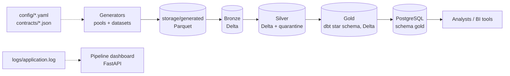

# ELT Lakehouse

[](https://github.com/MohammadSaif001/ELT-LAKEHOUSE/actions/workflows/ci.yml)

A batch ELT pipeline that generates synthetic e-commerce data (Olist schema),
lands it in a **Bronze → Silver → Gold** Delta Lake, models the Gold layer as a
star schema with dbt, publishes it to PostgreSQL, and shows pipeline health in a
read-only dashboard.

**Highlights**

- **Parallel data generation.** Process-based chunked generators use the spare CPU cores and stream to Parquet, so memory stays bounded.
- **Contract-driven Silver.** JSON schema contracts drive casting and validation. Invalid rows and referential-integrity failures go to quarantine tables instead of being dropped.
- **dbt Gold star schema.** Four facts and five dimensions with documented grains and keys, tested with dbt relationship, uniqueness and reconciliation tests.
- **Gold to PostgreSQL.** A separate, retryable serving stage with row-count verification.
- **Pipeline dashboard.** FastAPI view of run status, data quality, storage health and logs.

## Project status

| Area | Status | Notes |
| --- | --- | --- |
| Synthetic data generation | Implemented | Config-driven, parallel and chunked, for all eight datasets |
| Bronze layer | Implemented | Spark ingestion of the generated datasets into Delta tables |
| Silver layer | Implemented | Contract-based casting, validation, referential-integrity checks, quarantine tables |
| Data quality | Implemented | Null, duplicate, freshness, schema, business-rule and referential-integrity checks |
| Gold layer (dbt) | Implemented | 5 dimensions and 4 facts under `dbt_gold/`, run by `--gold-runner` |
| PostgreSQL serving | Implemented | `--serve-gold`; unit-tested, needs a running PostgreSQL (see [Serving Gold to PostgreSQL](#serving-gold-to-postgresql)) |
| Monitoring dashboard | Implemented | Read-only FastAPI dashboard for status, data quality, storage health and logs |
| Idempotent and resumable runs | Planned | See the [roadmap](#roadmap) |
| Incremental processing (CDC, merge, watermarks) | Planned | Module files exist as placeholders only |
| Kafka streaming ingestion | Planned | Module files exist as placeholders only; see [ADR 002](docs/adr/002_why_kafka.md) |
| Airflow orchestration | Planned | Placeholder files under `airflow/` |
| Prometheus and Grafana | Planned | Empty configuration files under `monitoring/` |

## Architecture



Every stage is a separate command, so you can rerun one stage without repeating
the earlier ones. The dashboard only reads the logs and storage folders; it
never starts jobs or writes data.

### Datasets

Eight related datasets: customers, geolocation, orders, order items, payments,
reviews, products and sellers. Schema contracts in [`contracts/`](contracts/)
define the expected shape of each. Runtime settings, generator distributions and
service settings live in [`config/`](config/).

### Gold data model

Gold is a star schema with shared dimensions. Full column lists, keys and
validation rules are in the [Gold catalog](docs/catalog.md).

| Table | One row per | Primary key |
| --- | --- | --- |
| `dim_date` | calendar day | `date_key` (yyyymmdd) |
| `dim_customer` | customer | `customer_key` |
| `dim_seller` | seller | `seller_key` |
| `dim_product` | product | `product_key` |
| `dim_location` | ZIP code prefix | `zip_code_prefix` |
| `fact_order_items` | order item | `order_id` + `order_item_id` |
| `fact_orders` | order | `order_id` |
| `fact_seller` | seller per purchase month | `seller_key` + `month` |
| `fact_product` | product per purchase month | `product_key` + `month` |

Surrogate keys are `xxhash64` of the business ID. Payments and reviews are
aggregated to order level before they are joined, so a multi-item order never
multiplies revenue.

## Requirements

- Python 3.11 to 3.14 (the versions tested by CI)
- Java 17 for Spark
- [`uv`](https://docs.astral.sh/uv/) for environments and dependencies
- PostgreSQL, only for `--serve-gold`

Dependencies are declared in [`pyproject.toml`](pyproject.toml) and locked in
[`uv.lock`](uv.lock).

## Quick start

```bash
git clone https://github.com/MohammadSaif001/ELT-LAKEHOUSE.git
cd ELT-LAKEHOUSE
uv sync
```

The project profiles the public Olist dataset from Kaggle. To download it and
build the profiling metadata, set up the
[Kaggle API credentials](https://www.kaggle.com/docs/api), then run:

```bash
uv run python elt_pipeline.py --setup
```

The setup step reuses a complete local dataset. Raw CSV files and generated
profiles are local artifacts and are excluded from Git.

### Run the stages

| Command | What it does | Output |
| --- | --- | --- |
| `--build-pool` | Generates the customer, product and seller pools | `metadata/pools/` |
| `--build-dataset` | Generates orders, items, payments, reviews, geolocation | `storage/generated/` |
| `--bronze-runner` | Ingests the generated data | `storage/bronze/` |
| `--silver-runner` | Casts, validates and cleans; quarantines bad rows | `storage/silver/` |
| `--gold-runner` | Builds the dbt Gold models | `storage/gold/` |
| `--serve-gold` | Publishes Gold to PostgreSQL | PostgreSQL schema `gold` |
| `--run-pipeline` | Setup, profiling, pools, datasets, Bronze, Silver and Gold in order | all of the above except serving |
| `--launch-dashboard` | Starts the dashboard at <http://127.0.0.1:5000> | |
| `--run-tests` | Runs the test suite | |
| `--send-report` | Emails the pipeline report (needs `EMAIL_ADDRESS`, `EMAIL_PASSWORD`, `RECIPIENT_EMAIL`) | |

Run any of them with `uv run -m python elt_pipeline.py <flag>`. Stage flags can be
combined, and they always run in dependency order. For example, a full run
followed by publishing:

```bash
uv run python -m elt_pipeline.py --run-pipeline
uv run python -m elt_pipeline.py --serve-gold
```

`--run-pipeline` needs Kaggle credentials only when the complete raw dataset is
not already present locally.

### Data volume

The default configuration creates pools of 1,000,000 customers, 100,000 products
and 200,000 sellers, and a dataset of 800,000 orders. Lower these values in
[`config/generator_config.yaml`](config/generator_config.yaml) when developing
on a small machine.

Reference run (800,000 orders, 16 logical cores, 14 GiB RAM,
measured **before** parallel generation was added):

| Stage | Seconds |
| --- | --- |
| Pools | 59 |
| Datasets | 135 |
| Bronze | 35 |
| Silver | 75 |
| Gold (dbt) | 114 |
| **Total** | **about 418** |

Unplugged, the same run took about 1.7x longer because the CPU was throttled.

## Configuration

### Parallel generation

| Variable | Default | Meaning |
| --- | --- | --- |
| `GENERATOR_WORKERS` | cores minus 2, at most 8 | Worker processes. `1` runs serially |
| `GENERATOR_SEED` | random | Makes the `random` draws repeatable (generated IDs still differ) |
| `GENERATOR_START_METHOD` | `fork` on Linux and macOS | Set to `spawn` if `fork` ever hangs |

### Serving Gold to PostgreSQL

`--serve-gold` reads the Gold Delta tables with Spark and writes them to
PostgreSQL over JDBC. Gold is not rebuilt, so a failed publish can be retried on
its own. After each table it compares the Delta and PostgreSQL row counts.

1. Create the roles, schema and tables once, as the database owner. Set your own
   role passwords first, and never commit real ones:
   `src/elt_lakehouse/warehouse/postgres/setup.sql`, then `create_tables.sql`,
   then `create_indexes.sql`.
2. Set the connection through environment variables:

| Variable | Default | Meaning |
| --- | --- | --- |
| `POSTGRES_HOST` | `localhost` | Database host |
| `POSTGRES_PORT` | `5432` | Database port |
| `POSTGRES_DB` | `elt_lakehouse` | Database name |
| `POSTGRES_USER` | `pipeline_writer` | Loader role; set it to the role that `setup.sql` creates for loading |
| `POSTGRES_PASSWORD` | none, required | Loader password |

3. Run `uv run python elt_pipeline.py --serve-gold`.

Table names, the schema and JDBC settings are in
[`config/postgress_config.yaml`](config/postgress_config.yaml). Missing tables
are created by Spark when `create_missing_tables` is `true`; those tables have no
keys or indexes. Keep it `false` and run the SQL files for a production-style
setup.

### Logs

Pipeline records go to `logs/application.log`. Dashboard records go to
`logs/dashboard.log` and do not mix into the pipeline log. Rows that fail Silver
referential-integrity checks are written to `storage/silver/quarantine/`.

## Testing

```bash
uv run pytest
```

CI runs an import smoke test and the full suite on Python 3.11 to 3.14.

- [`tests/unit/`](tests/unit/): generators, parallel chunking, configuration, dashboard parsing, PostgreSQL DDL and serving
- [`tests/data_quality/`](tests/data_quality/): data-quality and business rules
- [`tests/integration/`](tests/integration/): Bronze to Silver to Gold paths (need Spark)

The PostgreSQL DDL tests parse the SQL as real PostgreSQL and compare every
table's columns with the dbt models, so the two cannot drift apart.

## Repository layout

```text
config/       Runtime, generator, Spark and PostgreSQL configuration
contracts/    JSON schema contracts and schema utilities
dashboard/    Read-only FastAPI monitoring dashboard
dbt_gold/     dbt Gold models, sources and tests
docs/         Gold catalog, architecture, ADRs, runbooks
src/          Generators, ingestion, Spark jobs, quality checks, serving
tests/        Unit, data-quality and integration tests
storage/      Generated data and Bronze, Silver and Gold output (local)
airflow/      Placeholder DAG files (planned)
docker/       Local infrastructure configuration
monitoring/   Placeholder Prometheus and Grafana files (planned)
```

## Documentation

- [Gold layer catalog](docs/catalog.md): grains, keys, sources and columns
- [Architecture diagrams](docs/architecture/)
- [Architecture decision records](docs/adr/): why Delta Lake, Kafka and dbt
- [Runbook: pipeline failure](docs/runbooks/pipeline_failure.md)

## Roadmap

1. **Idempotent and resumable batch runs.** A rerun with unchanged inputs does no new work, a failed run resumes at the failed stage, and overlapping runs are blocked.
2. **Incremental processing.** Watermarks and Delta `MERGE` so new data is applied without a full refresh.
3. **Kafka streaming ingestion.** Producer, consumer and a Kafka-to-Bronze job with replay and recovery ([runbook](docs/runbooks/kafka_recovery.md)).
4. **Airflow orchestration** of the stages, plus **Prometheus and Grafana** monitoring.
5. **Run IDs and structured events** in the logs, so the dashboard reads events instead of matching log text.

## Known limitations

- Local, single-machine execution only: Spark runs in local mode.
- Generated data is synthetic and uses an Olist-style schema; it is not real customer data.
- The dashboard matches log messages by text. Changing a log message can change what the dashboard shows until structured events are added.